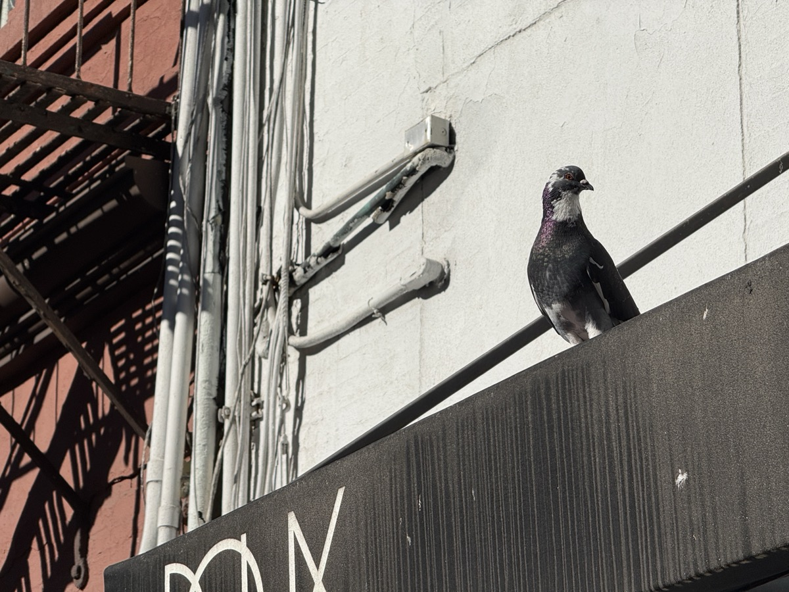
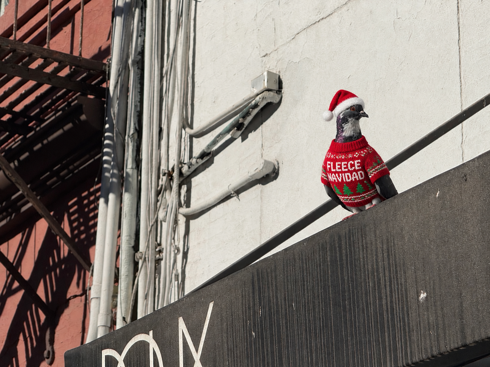

# walk-and-hack

Snap a pigeon on your iPhone. A minute later it's back on your phone, photorealistically dressed for the season: Halloween in October, Christmas in November and December.

<table>
  <tr>
    <th>Before</th>
    <th>After</th>
  </tr>
  <tr>
    <td></td>
    <td></td>
  </tr>
</table>

## How it works

1. **Post:** The **Post Pigeon** iOS Shortcut (share sheet → Post Pigeon) converts the photo to JPEG, resizes it, strips GPS, asks for a theme, and commits it to `pigeons/<theme>/` through the GitHub Contents API.
2. **Classify:** The push triggers a GitHub Action. [Typesafe](https://docs.typesafe.ai/images) (Jev) answers three questions about the photo: is it a pigeon, where is it, and what is it doing.
3. **Gate:** Not a pigeon? You get a "Pigeon not detected." push and the run stops, so nothing is spent on image generation.
4. **Direct:** The script picks a theme (photo date, or the `THEME` repo variable), then the outfit from the setting and the slogan from the activity, using `themes/<theme>/direction.json`.
5. **Transform:** OpenAI's image edit endpoint dresses the pigeon using `themes/<theme>/prompt.md`, filled with that direction.
6. **Deliver:** The result is committed to `transformed/<theme>/`, and a [Bark](https://github.com/Finb/Bark) push shows the slogan and opens the image when tapped.
7. **Browse:** Every transformed pigeon appears in the [gallery](https://vinceallenvince.github.io/walk-and-hack/), an edge-to-edge feed served by GitHub Pages.

```
 iPhone
 ┌──────────────────────┐
 │ Photos → Share →     │
 │ "Post Pigeon"        │  JPEG · 1200px · no GPS
 │ (iOS Shortcut)       │
 └──────────┬───────────┘
            │ PUT /repos/.../contents/pigeons/<theme>/pigeon-<timestamp>.jpg
            ▼
 GitHub repo ─────────────────────────────────────────────────────────────
 │  pigeons/**.jpg ─push──▶ GitHub Action: .github/workflows/transform.yml
 │                          scripts/transform.py
 │                               │
 │                               ▼
 │                     ┌───────────────────┐
 │                     │ Typesafe / Jev    │  subject · setting · activity
 │                     │ (classify)        │──▶ classifications/<name>.json
 │                     └─────────┬─────────┘
 │                    pigeon? ───┴─── no
 │                      │              │
 │                      ▼              ▼
 │           ┌───────────────────┐   Bark: "Pigeon not detected."
 │           │ pick theme, then  │     └─ tap ─▶ original photo (raw URL)
 │           │ outfit + slogan   │
 │           └─────────┬─────────┘
 │                     ▼
 │           ┌───────────────────┐
 │           │ OpenAI image edit │  themes/<theme>/prompt.md (template)
 │           └─────────┬─────────┘
 │                     ▼
 │           transformed/<theme>/<name>.png ── commit + push
 │                     │
 └─────────────────────┼───────────────────────────────────────────────────
                       ├──▶ Bark: "<theme title> · “<slogan>”"
                       │      └─ tap ─▶ transformed image (raw URL)
                       │
                       └──▶ GitHub Pages gallery (index.html)
                              reads transformed/<theme>/ via the GitHub API
                              vinceallenvince.github.io/walk-and-hack/
```

## Repo layout

| Path | What it is |
|---|---|
| `pigeons/<theme>/` | Originals, posted by the Shortcut. Photos directly in `pigeons/` get a theme by date. |
| `classifications/` | Jev's answers and the chosen direction per theme, one JSON per photo |
| `transformed/<theme>/` | Dressed-up results (PNG). PNGs directly in `transformed/` predate themes and count as Christmas. |
| `themes/<theme>/prompt.md` | Image prompt template with `{{PLACEHOLDERS}}` |
| `themes/<theme>/direction.json` | Title, season, styles by setting, phrases by activity |
| `scripts/transform.py` | Classify → gate → direct → transform |
| `.github/workflows/transform.yml` | Runs the script on every push to `pigeons/`, then commits and notifies |
| `index.html` | The gallery |

## Setup

Repository secrets (Settings → Secrets and variables → Actions):

| Secret | Used for |
|---|---|
| `OPENAI_API_KEY` | Image edit |
| `TYPESAFE_API_KEY` | Classification |
| `BARK_KEY` | Push notifications (the device key only, not the URL) |
| `REPLICATE_API_KEY` | FLUX renders on Replicate |

## iOS Shortcut setup

### 1. Create a GitHub token

On your phone, open **https://github.com/settings/personal-access-tokens/new** in Safari and create a fine-grained token:

- **Expiration:** your call. Shorter is safer; when it expires, generate a new token and paste it into the `Authorization` header (action 8 below).
- **Repository access:** Only select repositories → `walk-and-hack`
- **Permissions:** Repository permissions → **Contents → Read and write**

Copy the token right away, because GitHub shows it only once.

### 2. Build the Shortcut

Open **Shortcuts**, tap **+**, and name the shortcut **Post Pigeon**. In its details (ⓘ), turn on **Show in Share Sheet**.

The 📷 in each row opens a screenshot of that step, expanded to show its settings.

Add these actions in order, using the search bar at the bottom. Text in **bold** below means a variable pill: tap the field, then pick the variable from the bar above the keyboard. Don't type it in brackets.

| # | Action | Settings | |
|---|---|---|---|
| 1 | *Receive* (auto-added) | Receive **Apps and Images** from **Share Sheet** · If there's no input: **Ask For** **Photos** | [📷](docs/shortcut/steps-01-04.png) |
| 2 | Convert Image | Convert **Shortcut Input** to **JPEG** · Quality ~0.7 · **Preserve Metadata: off** (strips GPS) | [📷](docs/shortcut/steps-01-04.png) |
| 3 | Resize Image | Resize **Converted Image** to width **1200**, height auto | [📷](docs/shortcut/steps-01-04.png) |
| 4 | Base64 Encode | **Encode** **Resized Image** · Line Breaks: **None** | [📷](docs/shortcut/steps-04-06.png) |
| 5 | Format Date | **Current Date** · Date Format: **Custom** · `yyyyMMdd-HHmmss` | [📷](docs/shortcut/steps-04-06.png) |
| 6 | Choose from Menu | Prompt `Choose a theme` · items `halloween`, `christmas` · see below | [📷](docs/shortcut/steps-04-06.png) |
| 7 | Text | `pigeons/`**Menu Result**`/pigeon-`**Formatted Date**`.jpg` | [📷](docs/shortcut/steps-07-08.png) |
| 8 | Get Contents of URL | see below | [📷](docs/shortcut/steps-07-08.png) |
| 9 | Get Dictionary Value | Get **Value** for `content` in **Contents of URL** | [📷](docs/shortcut/steps-08-11.png) |
| 10 | Get Dictionary Value | Get **Value** for `download_url` in **Dictionary Value** | [📷](docs/shortcut/steps-08-11.png) |
| 11 | Copy to Clipboard | **Dictionary Value** | [📷](docs/shortcut/steps-10-12.png) |
| 12 | Show Notification | `🐦 Posted` | [📷](docs/shortcut/steps-10-12.png) |

**Step 6, Choose from Menu** ([branches](docs/shortcut/step-06-branches.png)): inside each branch, add a **Text** action holding the item's name (`halloween` under **halloween**, `christmas` under **christmas**). **Menu Result** is the output of the branch's last action, so an empty branch gives an empty theme. Item names must match a folder in `themes/` exactly, lowercase. To add a theme, add a menu item and its Text action.

**Step 8, Get Contents of URL** ([method and headers](docs/shortcut/steps-07-08.png), [request body](docs/shortcut/steps-08-11.png)):

- **URL:** `https://api.github.com/repos/vinceallenvince/walk-and-hack/contents/`**Text**
- **Method:** `PUT`
- **Headers:**
  - `Authorization`: `Bearer <your token>`, with the word `Bearer`, a space, then the token
  - `Accept`: `application/vnd.github+json`
- **Request Body:** JSON
  - `message`: `Add pigeon`
  - `content`: **Base64 Encoded**
  - `branch`: `main`

### 3. Use it

In Photos, tap **Share → Post Pigeon**, then pick a theme. The raw image URL lands on your clipboard, and about a minute later a Bark push brings the dressed-up pigeon.

### Troubleshooting

- **The file is 0 bytes:** step 4's input isn't **Resized Image**. A common slip is the pill landing in the Encode/Decode slot instead of the input slot. Delete the action, re-add it, then re-link `content` in step 8.
- **The filename shows `[Formatted Date]` or `[Text]` literally:** a variable was typed instead of inserted. Clear it and insert the pill.
- **The filename is `pigeon-.jpg`:** step 5 has no date. Set it to **Current Date**.
- **The path is `pigeons//pigeon-….jpg`:** a menu branch in step 6 is empty. Add its Text action.
- **Every run fails with `Unknown theme`:** a menu item doesn't match a folder in `themes/`. Fix the item, then move or delete the bad photo, since the run keeps retrying it.
- **The first run worked, later runs fail:** a fixed filename collided with an existing file, because GitHub rejects a PUT to a path that already exists without that file's `sha`. Fix the date variable in step 7.
- **401 or 404 from GitHub:** check the `Bearer ` prefix, the token's repo access, and that it hasn't expired.

## Tweaks

- **Outfits, slogans, and rules:** edit `themes/<theme>/direction.json`.
- **Add a theme:** add `themes/<name>/` with `prompt.md` and `direction.json`. Nothing else.
- **Pick the theme:** by default the photo's date decides (each theme's `season`). Set the repo variable `THEME` to override, or type a theme into Actions → Run workflow. A photo in `pigeons/<theme>/` always uses that theme.
- **Re-theme a pigeon:** run the workflow with another theme. The newest photo without that theme's PNG gets one.
- **Regenerate a pigeon:** delete its PNG in `transformed/<theme>/` and run the workflow (Actions → Run workflow).
- **Force a rejected photo through:** delete its JSON in `classifications/` and run the workflow.
- **Gallery filter:** add `?theme=halloween` to the gallery URL.
- **Compare renderers:** `RENDERERS` picks who renders, from `openai` and `flux` (FLUX.2 [flex] on Replicate). Both get the same prompt; FLUX writes `<name>--flux.png` next to the OpenAI image, and each sends its own push. Default `openai,flux`; set the repo variable `RENDERERS` (e.g. `openai`) or use the Run workflow box to change it.
- **Cost guard:** each run handles only the newest unprocessed photo (`MAX_PER_RUN = 1`), with one render per renderer.
